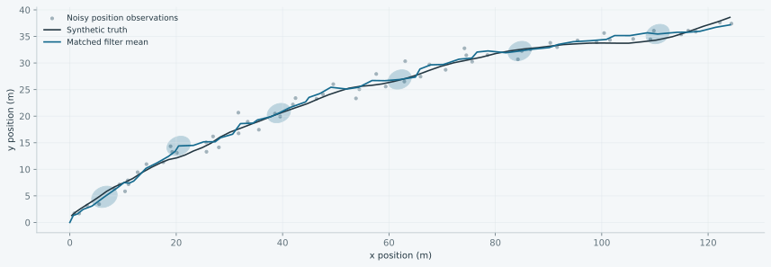

# Kalman tracking lab

**[View the report in your browser](https://Michaelhoang8.github.io/kalman-tracking-lab/)**

A linear Kalman filter implemented with NumPy solves and Joseph covariance updates, evaluated against an independent batch Gaussian least-squares oracle. The study compares motion-noise mismatch, missing measurements and innovation gating on reproducible synthetic 2D trajectories.

The repository retains full state, covariance and innovation histories—not just plots. This is an AI-assisted implementation and analysis using synthetic data, without a real robot or deployed navigation claim.



## Run and inspect

Python 3.13, NumPy 2.3.5 and Matplotlib 3.11.2:

```bash
python -m pip install -r requirements.txt
python -m unittest discover -s tests -v
python -m tracking --configuration sparse_measurements --seed 20261121 --output build/trajectory.json
python scripts/verify_results.py
python scripts/run_study.py --output-dir build/reproduction --runs 120 --samples 15
```

Open [the technical report](docs/report.html) directly. Its replay uses the saved illustrative states and works offline. The CLI generates one trajectory, validates its arguments, filters it and writes the full JSON result; it does not accept arbitrary external sensor formats. Exit 0 indicates success and 2 invalid arguments or I/O.

## Implementation

- State order `[x, y, vx, vy]`, position observations with correlated Gaussian measurement noise.
- Continuous white-acceleration spectral density with the integrated `dt³/3, dt²/2, dt` process covariance; explicitly distinct from piecewise-constant acceleration noise.
- Linear solves for gain and innovation statistics; no explicit matrix inverse or prebuilt filtering package.
- Joseph covariance correction, symmetric storage, finite-value and covariance validation.
- Prediction-only missing observations, optional inclusive NIS gate, and complete rejection records.
- General small linear prediction/correction functions in addition to the 4D tracking wrapper.

Tests include scalar analytic values, 24 independent whitened batch-Gaussian least-squares/QR comparisons, exact process-noise composition, missing data, gating boundaries, reproducibility and covariance checks. See [equations and numerical limits](docs/equations.md).

## Recorded study

120 independent simulated trajectories, five paired configurations, 60 time steps each: **36,000 estimated steps** retained in a compressed numeric archive. Statistics below use only the fixed final time, not all time steps as independent trials.

| Configuration | Position RMSE | 95% position coverage | Mean NEES |
|---|---:|---:|---:|
| Matched model | 1.24 m | 116/120 · 96.7% | 4.43 |
| Process noise underestimated ×30 | 2.22 m | 36/120 · 30.0% | 61.00 |
| Sparse + missing measurements | 1.56 m | 115/120 · 95.8% | 4.17 |
| Injected outliers, no gate | 1.27 m | 115/120 · 95.8% | 4.57 |
| Injected outliers, gated | 1.36 m | 112/120 · 93.3% | 4.74 |

The final-time result does **not** show a universal gating benefit: faults occur earlier, ungated estimates recover, and gating also rejects some legitimate observations. The illustrative time-series plots show the immediate response to faults. Gated statistics are descriptive because residual-based selection changes conditioning.

Coverage has Wilson 95% intervals over independent final-time indicators. NEES has a Monte Carlo standard error over independent runs. Nominal mean NEES = 4 applies to the correctly specified ungated four-state Gaussian model; it is not a calibration guarantee for every variant.

## Evidence

- [Report](docs/report.html), [screenshots](docs/screenshots/README.md), [recorded review](docs/recordings/README.md), [actual saved-state replay recording](docs/replay/README.md)
- [Full numeric archive](results/monte-carlo.npz) and [array schema](results/archive-schema.json)
- [Illustrative input](results/illustrative-input.json), [five complete JSON runs](results/illustrative/)
- [Per-run final metrics](results/final-metrics.json), [summary with intervals](results/summary.json), [raw timing samples](results/timings.csv)
- [Environment](results/environment.json), [source/artifact hashes](results/provenance.json), [test transcript](results/test-results.txt)
- [Statistical methodology](docs/methodology.md), [archive/reproduction guide](docs/archive.md)

This is a bounded linear-model study. It does not model sensor bias, unknown time stamps, nonlinear motion, orientation, data association, SLAM or operational safety. Tiny local timing samples are not robot latency guarantees.
