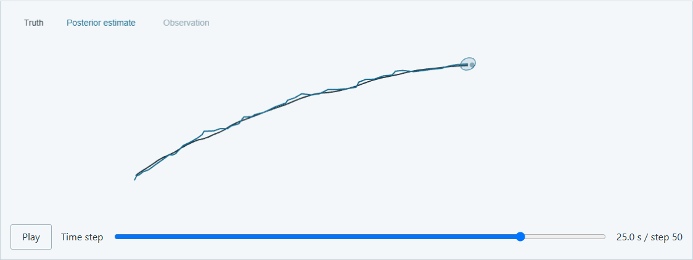

# Recorded saved-state playback

[Watch the actual browser recording](canvas-replay.mp4) · [Capture provenance](manifest.json)

The browser displays saved truth, observations, posterior means and position ellipses from the illustrative matched-model run. The recording exercises the actual Play/Pause controls and stops after step 50. It is silent, automated playback—not footage of a person implementing a filter.

Playback advances around one saved step every 160 milliseconds. This speed is illustrative and is unrelated to measured filtering runtime. The numerical trajectory spans 0.5 seconds per saved step.

The manifest hashes the simulation input, saved filter records, report, capture script, screenshot and video. To regenerate, install the optional media dependencies and FFmpeg, then run `python scripts/capture_replay.py`. On Windows it uses installed Edge; elsewhere install Playwright Chromium.
